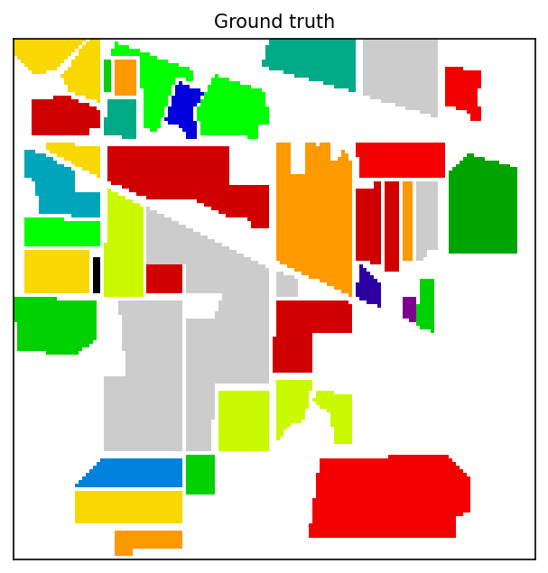
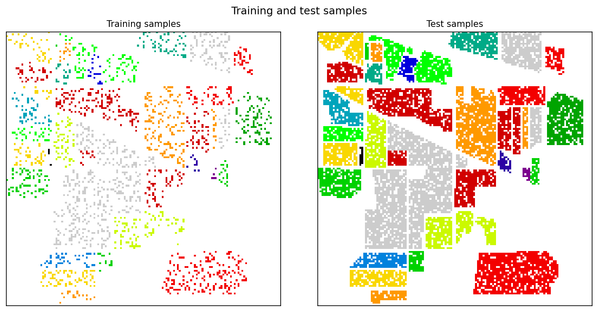
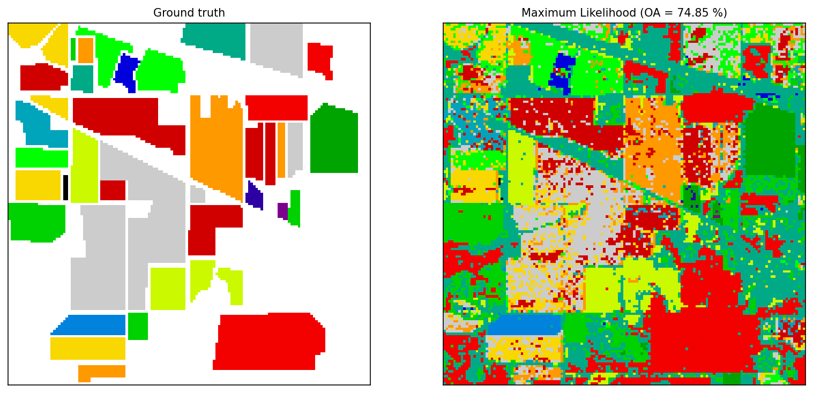

# Hyperspectral

**Hyperspectral image processing in Python: sample selection, band selection, Maximum Likelihood Classification, K-means clustering and accuracy assessment.**

Version **1.0.0** - Author **Mohsen Ghamary Asl** - License **MIT**


A small, dependency-light toolkit for hyperspectral remote-sensing experiments.
It started as a set of research scripts for the Indian Pines scene and is now a
tested Python package with a documented API, a command line interface and an
example for every algorithm.

```
ground truth -> random train/test split -> band selection (MTD) -> MLC -> accuracy (OA / AA / kappa)
```

| Ground truth | Training / test samples | Classification result |
|---|---|---|
|  |  |  |

---

## Features

| | |
|---|---|
| **Data handling** | `Hypercube` object for `(rows, columns, bands)` cubes; loads MATLAB `.mat`, NumPy `.npz` and `.npy`, keeps the ground truth and the class names, converts between the cube and the `(bands, pixels)` matrix in one call |
| **Sample selection** | random training/test samples **by number** or **by percentage** of each class, per-class lists allowed, reproducible with a `seed`, optional automatic skipping of classes that are too small |
| **Distances and angles** | pairwise Euclidean / squared-Euclidean / city-block / Chebyshev / cosine distances and spectral angles, fully vectorised (no Python loops) |
| **Band selection** | Maximum Tangent Discrimination (MTD) with a numerically stable, reproducible formulation |
| **Classification** | Maximum Likelihood Classifier with regularised covariances, optional priors, log-likelihood output and one-call scoring |
| **Clustering** | K-means with k-means++ initialisation, empty-cluster handling, convergence history |
| **Accuracy** | confusion matrix, overall accuracy (OA), average accuracy (AA), Cohen's kappa and per-class accuracy |
| **Figures** | maps, sample maps, mean spectra, band images, convergence curves - always head-less friendly |
| **CLI** | `python -m hyperspectral --data data/Indian_Pine.mat --samples 100` |
| **Quality** | 36 unit tests, continuous integration on Linux/macOS/Windows, type-annotated and documented API |

---

## Results on the bundled data

Indian Pines scene in `data/` (145 x 145 pixels, 200 bands, 16 classes), MTD
band selection + Maximum Likelihood Classification, fixed random seed
(`--seed 0`):

| Configuration | Bands used | Train / test | OA (%) | AA (%) | kappa |
|---|---|---|---|---|---|
| 100 samples per class (12 classes with >= 100 px) | 16 | 1200 / 8971 | **68.96** | 78.86 | 0.647 |
| the same split, all 200 bands (no band selection) | 200 | 1200 / 8971 | 60.41 | 71.80 | 0.552 |
| 20 % of each class, classes 4-16 | 18 | 2046 / 8220 | **77.40** | 74.89 | 0.744 |
| 10 % of each class, classes 7-16 (classic setup) | 11 | 967 / 8758 | 73.60 | 78.16 | 0.698 |

Band selection consistently helps: 16 bands give ~8.5 points more OA than all
200 bands, because the discarded bands are highly correlated and only add
noise to the covariance estimate.

```bash
# reproduce the first row
python -m hyperspectral --data data/Indian_Pine.mat --samples 100 --outdir results
# reproduce the third row
python -m hyperspectral --data data/Indian_Pine.mat --samples 20 --percent \
       --background 0,1,2,3 --outdir results
```

---

## Installation

```bash
git clone https://github.com/MohsenGhamaryAsl/Hyperspectral.git
cd Hyperspectral

python -m venv .venv
source .venv/bin/activate          # Windows: .venv\Scripts\activate

pip install -e .                   # or: pip install -r requirements.txt
```

Requirements: Python 3.8+, NumPy, SciPy and Matplotlib. `pip install -e ".[dev]"`
also installs the test tooling.

---

## Quick start

```python
from hyperspectral import (
    MaximumLikelihoodClassifier,
    class_means,
    load_hypercube,
    maximum_tangent_discrimination,
    select_bands,
    split_samples,
)

# 1) data
cube = load_hypercube("data/Indian_Pine.mat")
dataset = cube.dataset()                  # (bands, rows * columns)

# 2) reproducible 20 % training / 80 % test split
split = split_samples(
    dataset, cube.ground_truth,
    samples=20, mode="percent", seed=0,
    class_names=cube.name_map(),
)

# 3) band selection on the class-mean spectra
bands = maximum_tangent_discrimination(class_means(split.train_dataset,
                                                   split.train_counts))

# 4) train, classify, evaluate
clf = MaximumLikelihoodClassifier(shape=(cube.rows, cube.columns))
clf.fit(select_bands(split.train_dataset, bands), split.train_counts, split.labels)

prediction = clf.predict_map(select_bands(dataset, bands))
metrics = clf.score(split.test_map, select_bands(dataset, bands))
print(metrics["overall_accuracy"], metrics["kappa"])
```

### Command line

```bash
# Maximum Likelihood Classification (MTD band selection by default)
python -m hyperspectral --data data/Indian_Pine.mat --samples 100 --outdir results

# unsupervized K-means
python -m hyperspectral --data data/Indian_Pine.mat --task kmeans --clusters 8

# other useful switches
python -m hyperspectral --data data/Indian_Pine.mat --samples 20 --percent
python -m hyperspectral --data data/Indian_Pine.mat --bands all
python -m hyperspectral --data data/Indian_Pine.mat --bands 28,41,99
```

Every run writes the figures and a JSON report (`overall_accuracy`,
`average_accuracy`, `kappa`, per-class accuracy, runtime) to `--outdir`.

---

## Examples

| Script | What it shows |
|---|---|
| [`examples/01_load_and_inspect.py`](examples/01_load_and_inspect.py) | load a cube, list the classes, save a band image and the ground truth |
| [`examples/02_train_test_split.py`](examples/02_train_test_split.py) | sample selection by number and by percentage with a fixed seed |
| [`examples/03_mlc_indian_pines.py`](examples/03_mlc_indian_pines.py) | the complete pipeline: split -> MTD -> MLC -> OA/AA/kappa + report |
| [`examples/04_kmeans_clustering.py`](examples/04_kmeans_clustering.py) | unsupervised clustering and the convergence curve |
| [`examples/05_band_selection.py`](examples/05_band_selection.py) | MTD band selection and class mean spectra |

```bash
python examples/03_mlc_indian_pines.py
```

All the scripts are deterministic (`seed=0`) and write their figures to
`results/`.

---

## Package layout

```
Hyperspectral/
|-- hyperspectral/            # the package
|   |-- io.py                 # Hypercube, load/save, cube <-> matrix
|   |-- datasets.py           # cumulative ranges, class-mean spectra
|   |-- split.py              # random train/test sample selection
|   |-- distances.py          # pairwise distances (vectorised)
|   |-- angles.py             # spectral angles
|   |-- features.py           # Maximum Tangent Discrimination band selection
|   |-- mlc.py                # Maximum Likelihood Classifier
|   |-- cluster.py            # K-means
|   |-- metrics.py            # confusion matrix, OA, AA, kappa
|   |-- plotting.py           # figures
|   `-- cli.py                # python -m hyperspectral
|-- examples/                 # runnable, deterministic examples
|-- tests/                    # pytest suite (36 tests, synthetic data)
|-- data/                     # Indian Pines scene (.mat and .npz)
|-- docs/figures/             # figures used in this README
|-- pyproject.toml            # packaging, tooling configuration
|-- requirements.txt
|-- CITATION.cff
|-- CONTRIBUTING.md
`-- CHANGELOG.md
```

---

## API overview

| Function / class | Purpose |
|---|---|
| `load_hypercube(path)` | read `.mat` / `.npz` / `.npy` into a `Hypercube` |
| `Hypercube.dataset()` | `(bands, rows * columns)` matrix |
| `Hypercube.name_map()` | `{label: class name}` |
| `split_samples(dataset, ground_truth, samples, mode, seed=...)` | train/test split (`SplitResult`) |
| `pairwise_distances(X, Y, metric)` | distance matrix between vectors |
| `angles_between_vectors(X, Y, unit)` | spectral angle matrix |
| `maximum_tangent_discrimination(class_dataset)` | selected band indices |
| `select_bands(dataset, bands)` | reduce a dataset to the selected bands |
| `MaximumLikelihoodClassifier(shape)` | `.fit()`, `.predict()`, `.predict_map()`, `.score()` |
| `kmeans(data, n_clusters, seed=...)` | `KMeansResult` (labels, centres, inertia, history) |
| `evaluate(reference, prediction)` | OA, AA, kappa, per-class accuracy, confusion matrix |

Full docstrings (NumPy style) are available with `help()` or in the source.

---

## Data

`data/Indian_Pine.mat` and `data/Indian_Pine.npz` contain the same scene:

* `Pixels` / `Image_DataCube` - `(145, 145, 200)` uint16 data cube
* `Trained_Data` / `Ground_Truth` - `(145, 145)` uint8 ground truth, `0` = unlabelled
* `Classes` / `Classes_List` - the 17 class names (background included)

The Indian Pines scene was recorded by AVIRIS over an agricultural test site in
Indiana, USA; it is a standard benchmark distributed by Purdue University for
research use. Any other cube works as well - provide a `(rows, columns, bands)`
array plus a `(rows, columns)` label map.

To keep the repository small you can delete the `.npz` copy: both files hold the
same data, and the loader prefers whichever you pass.

---

## Migration from the old scripts

The original 2019 scripts were replaced by the package; the algorithms and the
results are unchanged, but the interfaces are now explicit instead of relying
on the "number of output arguments" trick:

| Old script | New API |
|---|---|
| `MLC.py` (`MLC` class) | `hyperspectral.mlc.MaximumLikelihoodClassifier` |
| `K_Means.py` (`kmeans`) | `hyperspectral.cluster.kmeans` / `cluster_map` |
| `MakeTT.py` (`MakeTT.makeTT`) | `hyperspectral.split.split_samples` (returns a `SplitResult`) |
| `makeDataset.py` | `hyperspectral.io.to_dataset` / `Hypercube.dataset()` |
| `classDataset.py`, `StartEnd.py` | `hyperspectral.datasets.class_dataset` / `cumulative_ranges` |
| `anglesBtwVectors.py` | `hyperspectral.angles.angles_between_vectors` |
| `distancesBtwVectors.py` | `hyperspectral.distances.pairwise_distances` |
| `MaximumTangentDiscrimination.py` | `hyperspectral.features.maximum_tangent_discrimination` |
| `nargoutController.py` | not needed any more (explicit return values) |

Improvements over the scripts: vectorised distance/angle computations (orders
of magnitude faster), numerically stable MTD (log-domain products) and MLC
(`slogdet` + regularisation instead of ad-hoc scaling), accuracy measured on
labelled test pixels only, reproducible randomness, tests and documentation.

---

## Contributing

Bug reports, ideas and pull requests are welcome - please read
[CONTRIBUTING.md](CONTRIBUTING.md) and open an
[issue](https://github.com/MohsenGhamaryAsl/Hyperspectral/issues).

```bash
pip install -e ".[dev]"
pytest
```

## Author

**Mohsen Ghamary Asl**

## License

MIT (c) 2019-2026 Mohsen Ghamary Asl - see [LICENSE](LICENSE).

If you use this code in a publication, please cite it with
[CITATION.cff](CITATION.cff) or link to this repository.

## References

* M. Imani and H. Ghassemian, "Band Clustering-based Feature Extraction for
  Hyperspectral Images Classification", *IEEE IGARSS*, 2013.
  <https://ieeexplore.ieee.org/document/6587529> (basis of the MTD band
  selection).
* Indian Pines / AVIRIS benchmark data, Purdue University.
